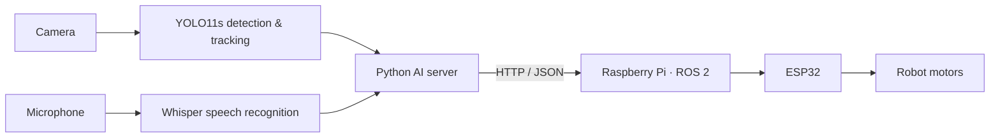

# `Duong31102005` · AI & Robotics

  
  
  

> **Building systems that see, listen, and move.**
>
> I work on projects that connect computer vision, speech AI, and embedded robotics—from real-time perception to safe robot control.

## Focus

- Real-time computer vision and object tracking
- Speech recognition and voice interfaces
- Robotics with ROS 2, Raspberry Pi, and ESP32
- Reliable communication and safety mechanisms for hardware

## Featured project

### [AI Robot — Vision & Voice Control](https://github.com/Duong31102005/AI_Robot)

An AI server for a mobile robot, combining YOLO11s person detection and tracking with Vietnamese speech recognition using OpenAI Whisper. The server sends control commands to a Raspberry Pi ROS 2 controller, with an ESP32 handling the motor hardware.

**Stack:** Python · YOLO11s · OpenCV · Whisper · HTTP/JSON · Raspberry Pi · ROS 2 · ESP32

## Tools I use

  
  
  
  
  

## More projects

- [Quản lí khóa học](https://github.com/Duong31102005/Quan-li-khoa-hoc)
- [BTL Nhóm 11](https://github.com/Duong31102005/btl_Nhom11)

---

  Learning by building · Vietnam

