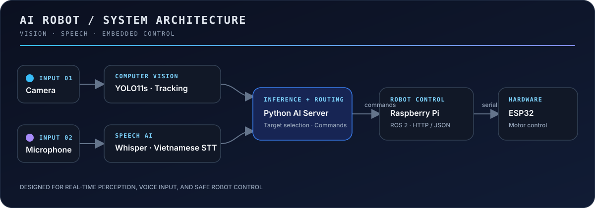

# Duong31102005 · Robotics, AI & Software

  
  
  

> Building and contributing to projects across robotics, AI, and software.
>
> From autonomous systems and computer vision to connected platforms and applied machine learning.

## Focus

- **Robotics and autonomy:** ROS 2, SLAM/Nav2, Raspberry Pi, and ESP32
- **AI:** computer vision, speech recognition, and applied ML
- **Software:** real-time dashboards, APIs, and integrated systems

## Collaborative projects

### [Autonomous Delivery Robot — ROS 2](https://github.com/namp12/robot_main)

A ROS 2 robot platform for Ubuntu and single-board computers, integrating camera and LiDAR sensing, SLAM/navigation, AI components, and an ESP32 control bridge.

**Stack:** ROS 2 · SLAM · Nav2 · YOLO · Raspberry Pi · RPLidar · ESP32

### [Robot Explorer Platform](https://github.com/namp12/Robot_web)

A web platform for remote robot control and monitoring, with live telemetry, mapping, navigation, and an AI copilot.

**Stack:** React · TypeScript · FastAPI · ROS 2 · WebSockets · ESP32

### [Autonomous Multi-Purpose Robot](https://github.com/namp12/Robot_Tu_Hanh)

A robot project covering exploration, delivery, and inventory-checking use cases, built around Raspberry Pi and ESP32 controllers.

**Stack:** Raspberry Pi 4 · ESP32-S3 · SLAM · YOLOv8

### [DNU Smart Canteen](https://github.com/namp12/cang_tin_truong_hoc)

A full-stack canteen management system spanning point of sale, kitchen operations, inventory, and a student-facing portal.

**Stack:** React · TypeScript · Node.js · MySQL

## Personal project

### [AI Robot — Vision & Voice Control](https://github.com/Duong31102005/AI_Robot)

An AI server for a mobile robot, combining YOLO11s person detection and tracking with Vietnamese speech recognition using OpenAI Whisper. It sends control commands to a Raspberry Pi ROS 2 controller, with an ESP32 handling the motor hardware.

**Stack:** Python · YOLO11s · OpenCV · Whisper · HTTP/JSON · Raspberry Pi · ROS 2 · ESP32

## More projects

- [BTL Nhóm 11](https://github.com/Duong31102005/btl_Nhom11)
- [Quản lí khóa học](https://github.com/Duong31102005/Quan-li-khoa-hoc)

---

  Learning by building

