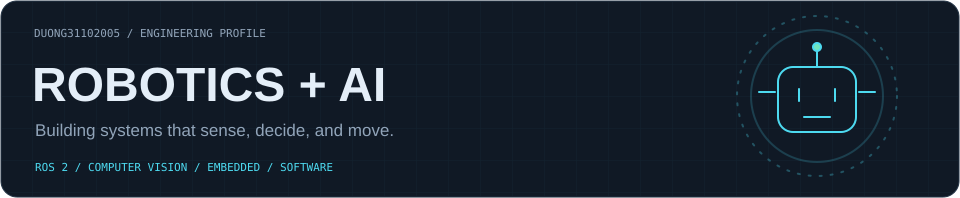
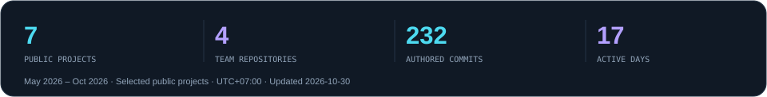
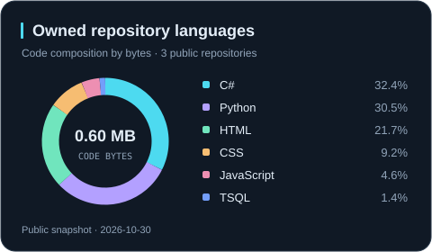
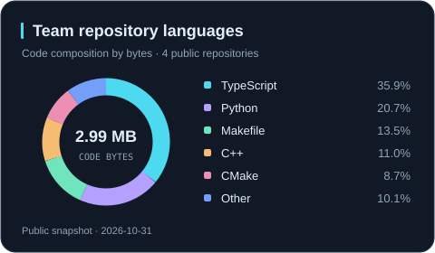
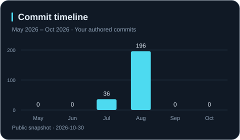
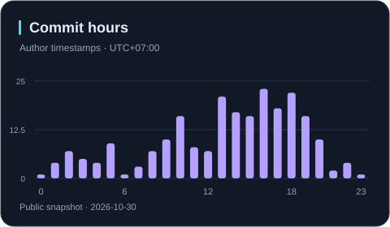
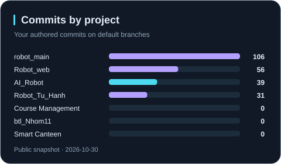
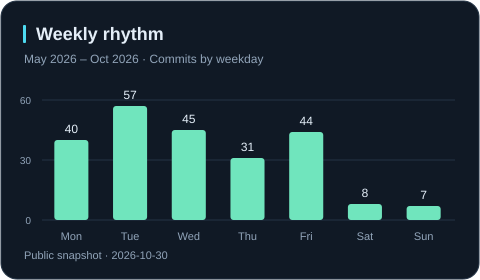

  

ROS 2 · Computer Vision · Embedded Systems · Web Platforms Building and contributing to projects that connect software with the physical world.

## System analytics

  
  

  
  

  
  

## Project matrix

<!-- PROJECT_TABLE:START -->
| Project | Focus | Relationship | Commits¹ |
|:---|:---|:---|---:|
| [AI_Robot](https://github.com/Duong31102005/AI_Robot) | Vision + voice robotics | Owned repo | 39 |
| [robot_main](https://github.com/namp12/robot_main) | ROS 2 navigation + delivery | Team project | 106 |
| [Robot_web](https://github.com/namp12/Robot_web) | Robot control + telemetry | Team project | 56 |
| [Robot_Tu_Hanh](https://github.com/namp12/Robot_Tu_Hanh) | Autonomous mobile robot | Team project | 31 |
| [cang_tin_truong_hoc](https://github.com/namp12/cang_tin_truong_hoc) | Canteen operations platform | Team project | 0 |
| [btl_Nhom11](https://github.com/Duong31102005/btl_Nhom11) | Web application | Owned repo | 0 |
| [Quan-li-khoa-hoc](https://github.com/Duong31102005/Quan-li-khoa-hoc) | Course management | Owned repo | 0 |

¹ Your authored commits · May 2026 – Oct 2026 · Default branches · Snapshot 2026-10-31
<!-- PROJECT_TABLE:END -->

Data scope &amp; methodology

Charts use seven selected public project repositories. Activity counts are your authored commits on their default branches. Language charts describe code bytes in owned or team repositories, including other contributors' code. Dates and hours use UTC+07:00; this is a scoped snapshot, not the full GitHub contribution calendar.

[Methodology & repository data](./ANALYTICS.md) · [Source snapshot](./data/metrics.json)

SENSE → DECIDE → ACT → IMPROVE

