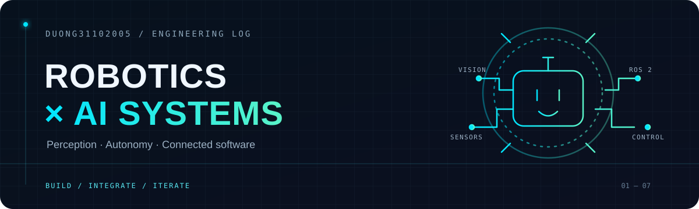

  

  
  
  

<h2 align="center">I build where code meets the physical world.</h2>

  Robotics, perception, embedded control, and the software that connects them. 
  I contribute to both team projects and personal builds, learning by integrating the whole system.

## 01 / Build areas

| **ROBOTS & AUTONOMY** | **AI & PERCEPTION** | **CONNECTED SOFTWARE** |
|:---|:---|:---|
| ROS 2 · SLAM / Nav2 · Raspberry Pi · ESP32 | YOLO · OpenCV · Whisper · Computer Vision | React · TypeScript · FastAPI · Node.js |

## 02 / Selected projects

<table>
  <tr>
    <td width="50%" valign="top">
      <h3>◉ AI Robot — Vision & Voice</h3>
      
<b>Personal build</b> · A mobile robot stack combining person detection and tracking, Vietnamese speech recognition, ROS 2 control, and ESP32 motor hardware.

      
Python · YOLO11s · OpenCV · Whisper · ROS 2 · ESP32

      <a href="https://github.com/Duong31102005/AI_Robot">Explore project →</a>
        
      

        
View system architecture

        
      

    </td>
    <td width="50%" valign="top">
      <h3>◉ Robot Explorer Platform</h3>
      
<b>Team project</b> · A web control and monitoring platform for robots, with live telemetry, mapping, navigation, and an AI copilot.

      
React · TypeScript · FastAPI · ROS 2 · WebSockets

      <a href="https://github.com/namp12/Robot_web">Explore project →</a>
    </td>
  </tr>
  <tr>
    <td width="50%" valign="top">
      <h3>◉ Autonomous Delivery Robot</h3>
      
<b>Team project</b> · A ROS 2 robot integrating camera and LiDAR sensing, navigation, AI components, and an ESP32 control bridge.

      
ROS 2 · SLAM / Nav2 · Raspberry Pi · RPLidar · ESP32

      <a href="https://github.com/namp12/robot_main">Explore project →</a>
    </td>
    <td width="50%" valign="top">
      <h3>◉ Autonomous Multi-Purpose Robot</h3>
      
<b>Team project</b> · A robot platform designed for exploration, delivery, and inventory-checking tasks.

      
Raspberry Pi 4 · ESP32-S3 · SLAM · YOLOv8

      <a href="https://github.com/namp12/Robot_Tu_Hanh">Explore project →</a>
    </td>
  </tr>
</table>

## 03 / Beyond robotics

### DNU Smart Canteen · Team project
A full-stack canteen platform for point of sale, kitchen operations, inventory, and student services.  
**React · TypeScript · Node.js · MySQL** · [View repository](https://github.com/namp12/cang_tin_truong_hoc)

Also: [BTL Nhóm 11](https://github.com/Duong31102005/btl_Nhom11) · [Course Management](https://github.com/Duong31102005/Quan-li-khoa-hoc)

## 04 / How I like to build

**Sense → Decide → Act → Improve**

I enjoy contributing across disciplines: connecting hardware, robot software, AI features, and useful interfaces into one working system.

  BUILD / TEST / ITERATE 
  <a href="https://github.com/Duong31102005">GitHub profile</a>

